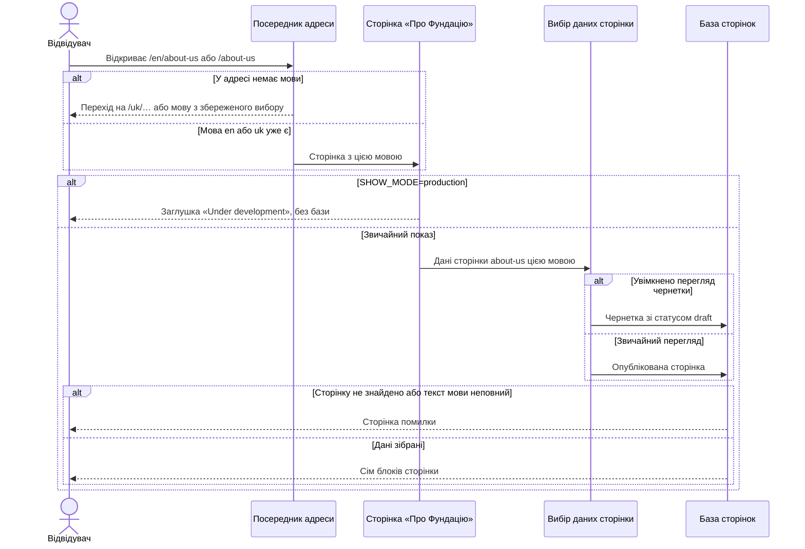

# Сторінка «Про Фундацію»

## Короткий опис

Сторінка «Про Фундацію» відкривається за адресою `/{lang}/about-us`, наприклад `/en/about-us` або `/uk/about-us`. Вона показує відвідувачу блоки про фонд: вступ, відомості, місію, цілі, офіс Лятошинського, напрями роботи і засновників. Тексти беруться з бази за кодом сторінки `about-us` і мовою адреси. Якщо сайт запущено зі змінною `SHOW_MODE=production`, замість цих блоків показується заглушка «Under development», і база не читається.

## User stories

- Як відвідувач, я хочу відкрити сторінку «Про Фундацію» українською або англійською, щоб прочитати місію і діяльність фонду.
- Як редактор, я хочу переглянути чернетку (неопубліковану версію) цієї сторінки, щоб перевірити текст до публікації.

## Потік даних



Відвідувач відкриває адресу з мовою. Посередник адреси лише додає мову, якщо її немає, і не перевіряє назву сторінки, режим показу чи чернетку. Далі сторінка або одразу показує заглушку, або читає одну мову тексту з бази. Діаграму складено за кодом, у браузері не звірено.

## Бізнес-правила

| ID | Правило | Звідки відомо |
| --- | --- | --- |
| BR-01 | Сторінка доступна лише з мовою `en` або `uk` в адресі. Без мови відвідувача перенаправляють на `/uk/…` або на мову з збереженого вибору. | код, `middleware.ts` |
| BR-02 | Якщо `SHOW_MODE` дорівнює `production`, сторінка показує заглушку «Under development» і не читає базу. | код, `app/[lang]/about-us/page.tsx`, `app/lib/utils/isProductionMode.ts` |
| BR-03 | У звичайному показі сторінка читає опублікований документ зі статусом published. | код, `pagesData.repository.ts` |
| BR-04 | Якщо ввімкнено перегляд чернетки (кука після `/api/preview`), читається інший сервіс і колекція чернеток зі статусом draft. | код, `resolvePageData.ts` |
| BR-05 | Код сторінки `about-us` входить до дозволеного списку разом із `privacy-policy`, `research`, `biography` і `cooperation`. | код, `schema-factory.ts` |
| BR-06 | Текст лишається лише обраною мовою. Якщо перекладу цієї мови немає, відвідувач бачить помилку, а не другу мову. | код, `pagesDataService.ts`, `localization.ts` |
| BR-07 | На сторінці до семи блоків. Блок без даних не показується. | код, `app/[lang]/about-us/page.tsx` |
| BR-08 | Початкове наповнення бази записує опубліковані сторінки і не записує чернетки. | код, `scripts/seed-memory-mongo.js` |

## Acceptance Criteria

### AC-01. Сторінка українською і англійською

```text
Given у базі є опублікована сторінка about-us з текстами uk і en
And SHOW_MODE не дорівнює production
When відвідувач відкриває /uk/about-us і потім /en/about-us
Then кожна адреса показує блоки лише своєю мовою
```

(BR-01, BR-03, BR-06, BR-07)

### AC-02. Адреса без мови

```text
Given відвідувач не зберігав вибір мови
When він відкриває /about-us
Then його перенаправляють на /uk/about-us
```

(BR-01)

### AC-03. Заглушка в режимі production

```text
Given SHOW_MODE дорівнює production
When відвідувач відкриває /en/about-us
Then він бачить «Under development»
And запиту сторінки до бази немає
```

(BR-02)

### AC-04. Немає опублікованої сторінки

```text
Given у базі немає опублікованого документа about-us
And перегляд чернетки вимкнено
And SHOW_MODE не дорівнює production
When відвідувач відкриває /uk/about-us
Then він бачить сторінку «не знайдено»
```

(BR-03)

### AC-05. Чернетка

```text
Given увімкнено перегляд чернетки
And у колекції чернеток немає документа about-us
When відвідувач відкриває /uk/about-us
Then він бачить сторінку «не знайдено»
And опублікована сторінка йому не підставляється
```

(BR-04, BR-08)

### AC-06. Немає перекладу обраної мови

```text
Given опублікована сторінка about-us не має тексту en
When відвідувач відкриває /en/about-us
Then він не бачить український текст замість англійського
And бачить сторінку помилки
```

(BR-06)

## Ключові файли

| Файл | Роль у фічі |
| --- | --- |
| `middleware.ts` | Додає мову в адресу і пропускає вже готові `/en` та `/uk`. |
| `app/[lang]/layout.tsx` | Відхиляє мову, якої немає в списку. |
| `app/[lang]/about-us/page.tsx` | Показує заглушку або збирає блоки сторінки. |
| `app/lib/utils/isProductionMode.ts` | Визначає режим `SHOW_MODE=production`. |
| `app/services/pages-data/resolvePageData.ts` | Обирає опубліковані дані або чернетку. |
| `app/di/container.ts` | Підставляє сервіс даних сторінки для цього запиту. |
| `app/services/pages-data/pagesDataService.ts` | Перевіряє сторінку і залишає одну мову. |
| `app/services/pages-data/schema-factory.ts` | Дозволяє код `about-us` і збирає схему цієї сторінки. |
| `app/infrastructure/repositories/pages-data/pagesData.repository.ts` | Читає документ із бази і перевіряє повну структуру. |
| `app/lib/utils/errorPageFactory.tsx` | Обирає сторінку помилки за текстом помилки. |
| `scripts/seed-memory-mongo.js` | Записує початкові опубліковані сторінки. |
| `docs/architecture.md` | Містить докладну діаграму цього ж потоку. |

## Відкриті питання

### Q-01. Чи має заглушка «Under development» лишатися на час публічного запуску?

**Навіщо:** зараз будь-який запуск із `SHOW_MODE=production` ховає сторінку ще до читання бази. Невідомо, чи це тимчасовий стан, чи правило релізу.

**Хто відповідає:** керівник Фундації.

### Q-02. Що відвідувач має бачити, якщо перекладу обраної мови немає?

**Навіщо:** код не підставляє другу мову, але окрема сторінка «немає перекладу» не з’являється: текст помилки не збігається з очікуваним точно.

**Хто відповідає:** редактор сайту.

### Q-03. Чи має початкове наповнення створювати чернетки?

**Навіщо:** зараз чернетки порожні, тож перегляд чернетки завжди закінчується «не знайдено».

**Хто відповідає:** редактор сайту.
