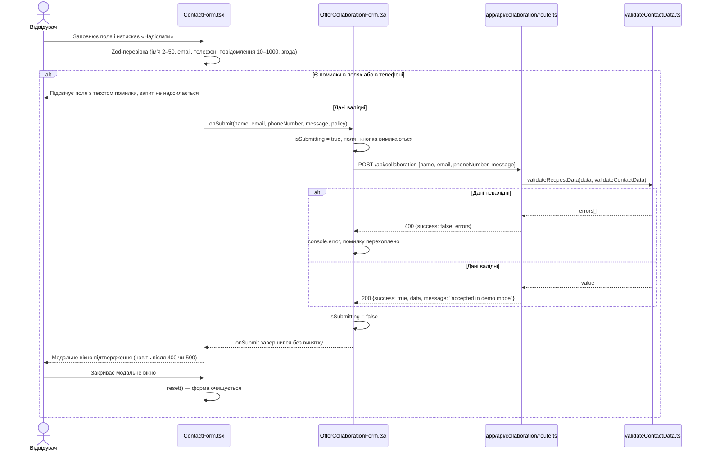

# Архітектура запитів

Діаграма показує публічні сторінки, які викликають HTTP API, далі маршрут `route.ts`, сервіс із `app/di/container.ts` і репозиторій із моделями MongoDB. `app/api/collaboration/route.ts` лише приймає форму і не звертається до сервісів чи бази. `app/api/blob-url/route.ts` віддає файли з `public` і теж не має репозиторію. Сторінки на кшталт `about-us`, `biography` і `news` читають сервіси на сервері через `app/di/container.ts` без окремого API-виклику, тому на схемі їх немає.

```mermaid
flowchart TD
  artistry["app/[lang]/artistry/page.tsx"]
  research["app/[lang]/research/page.tsx"]
  archive["app/[lang]/archive/page.tsx"]
  cooperation["app/[lang]/cooperation/page.tsx"]
  contacts["app/[lang]/contacts/page.tsx"]

  compFilters["app/api/compositions/filters/route.ts"]
  compData["app/api/compositions/data/route.ts"]
  compTitles["app/api/compositions/titles/route.ts"]
  blob["app/api/blob-url/route.ts"]
  sciFilters["app/api/scientific-works/filters/route.ts"]
  sciData["app/api/scientific-works/data/route.ts"]
  sciTitles["app/api/scientific-works/titles/route.ts"]
  fundsRoute["app/api/funds/route.ts"]
  collab["app/api/collaboration/route.ts"]

  di["app/di/container.ts"]

  artistrySvc["app/services/artistry/artistryService.ts"]
  sciSvc["app/services/scientific-works/scientificWorks.ts"]
  fundsSvc["app/services/funds/fundsService.ts"]

  compRepo["app/infrastructure/repositories/artistry/compositions.repository.ts"]
  sciRepo["app/infrastructure/repositories/scientific-works/scientificWorks.repository.ts"]
  fundsRepo["app/infrastructure/repositories/funds/funds.repository.ts"]

  categories["app/infrastructure/models/artistry/artistryCategoriesData.ts"]
  genres["app/infrastructure/models/artistry/artistryGenreData.ts"]
  opuses["app/infrastructure/models/artistry/artistryOpusData.ts"]
  compositions["app/infrastructure/models/artistry/artistryTableData.ts"]
  authors["app/infrastructure/models/scientific-works/scientificWorksAuthor.ts"]
  works["app/infrastructure/models/scientific-works/scientificWorksTableData.ts"]
  fundModel["app/infrastructure/models/archive/Fund.ts"]
  caseModel["app/infrastructure/models/archive/Case.ts"]
  documentModel["app/infrastructure/models/archive/Document.ts"]

  artistry --> compFilters
  artistry --> compData
  artistry --> compTitles
  artistry --> blob
  research --> sciFilters
  research --> sciData
  research --> sciTitles
  archive --> fundsRoute
  cooperation --> collab
  contacts --> collab

  compFilters --> di
  compData --> di
  compTitles --> di
  sciFilters --> di
  sciData --> di
  sciTitles --> di
  fundsRoute --> di

  di --> artistrySvc
  di --> sciSvc
  di --> fundsSvc

  artistrySvc --> compRepo
  sciSvc --> sciRepo
  fundsSvc --> fundsRepo

  compRepo --> categories
  compRepo --> genres
  compRepo --> opuses
  compRepo --> compositions
  sciRepo --> authors
  sciRepo --> works
  fundsRepo --> fundModel
  fundsRepo --> caseModel
  fundsRepo --> documentModel
```

---

## Надсилання форми контактів

Діаграма показує, що відбувається, коли відвідувач заповнює форму на `/contacts`. Форму рендерить `OfferCollaborationForm` всередині `ContactsInfo`, а поля і перевірку — `ContactForm`. Запит іде в `app/api/collaboration/route.ts`, а не в `app/api/contact/route.ts`: останній маршрут зараз ніхто не викликає. Сервер лише перевіряє дані через `validateContactData` і повертає їх назад — нічого не зберігає і листів не надсилає. Чекбокс згоди з політикою перевіряється тільки в браузері і на сервер не передається. Якщо запустити сайт із `SHOW_MODE=production`, замість форми показується `UnderDevelopment`.

Діаграму звірено в браузері на `/en/contacts` 17.11.2026:

- Порожня форма: показуються помилки полів, запит не надсилається.
- Валідні дані: `POST /api/collaboration` → 200 `accepted in demo mode`, поле `policy` у запиті відсутнє, з'являється «Thank you», після закриття форма очищується.
- Невалідні дані напряму на маршрут: 400 зі списком помилок.
- Відповідь 500 (імітована в браузері): у консолі `console.error`, але відвідувач однаково бачить «Thank you».
- Запитів на `/api/contact` немає.
