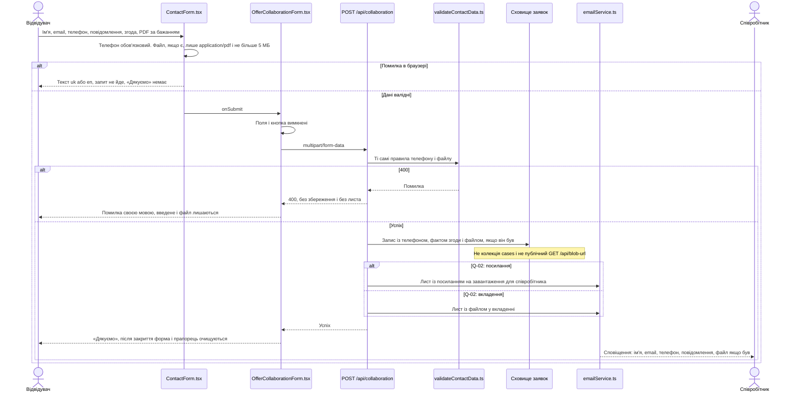

# Контактна форма: обов'язковий телефон і вкладення PDF

Опис зміни з [issue #2](https://github.com/olga-malyniak/sdd-workshop-olga/issues/2). Документ зіставлено з кодом, коментарями issue і розмовою 23.11.2026. Чого в коді й у вимогах немає, винесено у [відкриті питання](#8-відкриті-питання).

---

## 1. Короткий опис і вихідний запит

Відвідувач пише Фундації через форму на сторінці «Контакти». Зміна робить телефон обов'язковим, додає необов'язковий PDF (CV або портфоліо) до 5 МБ і показує цей файл у сповіщенні як посилання або вкладення. Зараз форма нічого не зберігає і листів не надсилає: `POST /api/collaboration` перевіряє JSON і повертає тіло назад.

Вихідний запит з issue #2, дослівно:

> We want to tighten up the contact form. Phone number should be mandatory.
> We should also let visitors attach a document (CV or portfolio) when they write
> to us. Notifications need to reflect the new field.

Обсяг, який реалізуємо:

1. Зробити телефон обов'язковим у формі контактів.
2. Додати необов'язкове поле для файлу (лише PDF, до 5 МБ).
3. Включити вкладення як посилання або завантаження в лист-сповіщення.

«Контакти» і «Співпраця» зараз ділять одну форму й один маршрут. Ціль issue стосується форми «Контакти». Поки замовник не поширить зміну на обидві сторінки, «Співпраця» лишається з нинішніми правилами (Q-03).

---

## 2. Бізнес-контекст

### Ціль

Дати співробітнику Фундації все потрібне, щоб відповісти на заявку з форми «Контакти» без додаткового листування. Кожна заявка має містити телефон, за потреби — CV або портфоліо у PDF, і зберігатися в одному місці, доступному лише цьому співробітнику.

### Метрика успіху

**Основна:** 100 % заявок після релізу мають валідний телефон і доступні співробітнику разом із файлом, якщо його додали. Втрачених заявок і файлів, які не відкриваються, немає.

**Допоміжні.** Числа нижче названі в issue, але не є порогом приймання, доки їх не підтвердять:

- частка заявок, після яких довелося окремо просити телефон, — ціль 0 %; CV лишається необов'язковим, тож відсутній файл не є провалом метрики;
- частка невдалих відправок через помилку завантаження — орієнтир близько 2 %;
- 100 % заявок і файлів, старших за 6 місяців від дати надходження, видаляються; перевірка щомісяця;
- обсяг сховища не перевищує X % ліміту. X не названо (Q-04).

Базового значення немає: форма зараз нічого не зберігає (Q-01).

### Обмеження

| ID | Обмеження | Джерело |
| --- | --- | --- |
| NFR-01 | Заявка і файл видаляються не пізніше ніж через 6 місяців від дати надходження, разом із копіями в сповіщеннях і резервних копіях. | замовник |
| NFR-02 | Переглядати заявки й завантажувати файли може лише окремий співробітник. Публічного доступу немає. Журнал переглядів і завантажень у issue позначено як пропозицію, не як вирішену вимогу (Q-07). | замовник; журнал — пропозиція |
| NFR-03 | Один PDF, не більше 5 МБ, бо сховище обмежене. Помилку формату чи розміру відвідувач бачить до відправки. Публічних посилань на файл немає. Перевірка типу за вмістом файлу в issue позначена як пропозиція (Q-06). | замовник; вміст файлу — пропозиція |
| NFR-04 | Перед відправкою відвідувач дає згоду, і факт згоди зберігається із заявкою. Політика конфіденційності каже, що зберігається, хто має доступ і скільки часу. | закон України «Про захист персональних даних» |
| NFR-05 | Правила телефону й файлу однакові в браузері й на сервері. Після помилки введені дані не губляться. | поточне правило проєкту |

Телефон, який уже перевіряє сервер, лишається таким: `+` і лише цифри, від 11 до 16 символів разом із `+` (`app/constants/validation.ts`).

---

## 3. User stories

- Як співробітник Фундації, я хочу бачити телефон у кожній заявці з «Контактів», щоб відповісти без додаткового листування.
- Як відвідувач, я хочу за бажанням прикріпити один PDF до 5 МБ, щоб передати CV або портфоліо разом із зверненням.
- Як співробітник, я хочу відкрити цей PDF із того самого запису і побачити його в сповіщенні, щоб не просити файл ще раз.
- Як відвідувач, я хочу зрозуміти помилку своєю мовою до відправки і не втратити введене, якщо сервер відхилив заявку.
- Як замовник, я хочу, щоб заявку і файл бачив лише окремий співробітник і щоб їх не було довше 6 місяців.

---

## 4. Діаграма послідовності

Як форма працює зараз, описано в [`docs/architecture.md`](./architecture.md): обидві сторінки шлють JSON на `POST /api/collaboration`, сервер лише перевіряє поля, а «Дякуємо» відкривається навіть після помилки, бо виняток перехоплюється всередині `OfferCollaborationForm`.

Нижче цільовий потік для «Контактів». Сховища заявок у коді ще немає. Посилання чи вкладення в листі — розвилка Q-02.

Діаграму складено за кодом і issue 23.11.2026. У браузері цільовий потік не звірявся: його ще немає в коді.

---

## 5. Таблиця правил

Три стани: **Є зараз**, **Має бути**, **Хто вирішив**. Останні два заповнені лише там, де це сказано замовником, у NFR issue або випливає з них. Порожня клітинка означає, що рішення немає.

| ID | Правило | Є зараз | Має бути | Хто вирішив |
| --- | --- | --- | --- | --- |
| RULE-01 | Ім'я обов'язкове, 2–50 символів; у формі краї зрізаються | Так | | |
| RULE-02 | На сервері ім'я — рядок 2–50; пробіли не зрізаються | Так | | |
| RULE-03 | У полі імені не ввести більше 50 символів | Так | | |
| RULE-04 | Email у формі обов'язковий, перевірка Zod `.email()` | Так | | |
| RULE-05 | На сервері email за `EMAIL_PATTERN`. Шаблон не приймає `+` у локальній частині, Zod приймає | Так | | |
| RULE-06 | Довжина email не обмежена | Так | | |
| RULE-07 | Порожній телефон не перевіряється | Так | Телефон обов'язковий | замовник |
| RULE-08 | Порожній рядок телефону сервер пропускає | Так | Телефон обов'язковий | замовник |
| RULE-09 | Якщо номер є: `+` і цифри, 11–16 символів | Так | | |
| RULE-10 | Сервер не знімає маску: номер із маскою на API дає 400 | Так | | |
| RULE-11 | Код країни з довідника 61 країни перевіряє лише браузер | Так | | |
| RULE-12 | Мінімум цифр залежить від країни; стеля 16 цифр лише в масці | Так | | |
| RULE-13 | Невідомий код країни лишає цифри з `+` і показує помилку | Так | | |
| RULE-14 | Номер із `0` у масці стає українським `+38` | Так | | |
| RULE-15 | Перед відправкою з форми маска знімається до `+` і цифр | Так | | |
| RULE-16 | У поля телефону немає `maxLength`; довжину ріже маска | Так | | |
| RULE-17 | Якщо маска в помилці, відправка не починається | Так | | |
| RULE-18 | Кнопка не шле форму, поки телефон невалідний. Текст причини — RULE-29 | Так | | |
| RULE-19 | Повідомлення у формі 10–1000 символів, краї зрізаються | Так | | |
| RULE-20 | На сервері повідомлення 10–1000, пробіли не зрізаються | Так | | |
| RULE-21 | У повідомлення не ввести більше 1000 символів | Так | | |
| RULE-22 | В імені й повідомленні немає фільтра символів | Так | | |
| RULE-23 | Довжина рахується в одиницях UTF-16 | Так | | |
| RULE-24 | Сервер приймає лише рядки | Так | | |
| RULE-25 | Сервер повертає всі помилки одразу | Так | | |
| RULE-26 | Поля файлу немає | Ні | Один необов'язковий PDF до 5 МБ | замовник |
| RULE-27 | Помилки під полями беруться з `uk.json` або `en.json` | Так | | |
| RULE-28 | Помилки з'являються під час введення | Так | | |
| RULE-29 | Для телефону є лише текст формату, без тексту обов'язковості | Так | | |
| RULE-30 | Підказка ліміту імені й повідомлення зникає за 3 секунди | Так | | |
| RULE-31 | У підписі телефону немає `*` | Так | Телефон отримає `*` | замовник |
| RULE-32 | Тексти помилок сервера англійською, форма їх не показує | Так | | |
| RULE-33 | Помилка валідації — статус 400 | Так | | |
| RULE-34 | Неочікувана помилка `/api/collaboration` — 500 | Так | | |
| RULE-35 | `/api/contact` без `try/catch`; форма його не викликає | Так | | |
| RULE-36 | «Дякуємо» відкривається навіть після 400 і 500 | Так | | |
| RULE-37 | Текст вікна: «ДяКуЮ» / «Ваш запит надіслано» / «Закрити» | Так | | |
| RULE-38 | Помилка сервера пишеться лише в консоль браузера | Так | | |
| RULE-39 | Гілка `previewUrl` у формі є, сервер такого поля не повертає | Так | | |
| RULE-40 | Поля спочатку порожні, згода знята | Так | | |
| RULE-41 | На час запиту поля й кнопка вимкнені | Так | | |
| RULE-42 | Тіло запиту — JSON на `/api/collaboration` | Так | | |
| RULE-43 | Успішна відповідь повертає отримане тіло, разом із зайвими полями | Так | | |
| RULE-44 | Успіх `/api/collaboration` — 200 і текст демо-режиму | Так | | |
| RULE-45 | Після закриття «Дякуємо» форма очищується | Так | | |
| RULE-46 | `SHOW_MODE=production` ховає сторінки з формою заглушкою | Так | | |
| RULE-47 | Ліміту числа відправок немає | Так | | |
| RULE-48 | Капча вимкнена: `POST /api/verify` завжди 503, форма його не викликає | Так | | |
| RULE-49 | У `next.config.ts` немає ліміту розміру тіла | Так | | |
| RULE-50 | Заявка в базі | Ні | Зберігається в одному місці для співробітника | замовник |
| RULE-51 | Доступ лише окремого співробітника | Ні | Публічного доступу немає | замовник |
| RULE-52 | Строк зберігання | Ні | Не довше 6 місяців від дати надходження | замовник |
| RULE-53 | Прапорець згоди спочатку знятий | Так | | |
| RULE-54 | Без згоди форма не відправляється | Так | | |
| RULE-55 | Біля прапорця є посилання на політику | Так | | |
| RULE-56 | Згода не входить у JSON і на сервері не перевіряється | Так | Факт згоди зберігається із заявкою; політика описує склад, доступ і строк | NFR-04, закон України «Про захист персональних даних» |
| RULE-57 | Після закриття «Дякуємо» прапорець знімається | Так | | |
| RULE-58 | Лист після відправки | Ні: `sendEmail` — заглушка, маршрути її не викликають | | |
| RULE-59 | Шаблон листа містить ім'я, email, телефон і повідомлення | Так, лише як шаблон | Лист показує нове поле файлу | замовник |
| RULE-60 | Телефон у шаблоні є, лише якщо його передали | Так | Телефон у листі є завжди | замовник |
| RULE-61 | Тип форми в шаблоні за замовчуванням — Contact | Так | | |
| RULE-62 | Шаблон англійською, час — у локалі сервера | Так | | |
| RULE-63 | Ім'я і повідомлення в HTML підставляються без екранування | Так | | |
| RULE-64 | У HTML перенос стає ` `; у текстовій версії перенос лишається | Так, лише як шаблон | | |
| RULE-65 | Адреси пошти і сховища файлів | Ні: у `app/config/index.ts` їх немає | | |
| RULE-66 | «Контакти» і «Співпраця» ділять форму, валідатор і `/api/collaboration` | Так | | |

Джерела рядків: `ContactForm.tsx`, `validateContactData.ts`, `constants/validation.ts`, `OfferCollaborationForm.tsx`, `emails.ts`, `emailService.ts`, `upload.ts`, `next.config.ts`.

---

## 6. Критерії приймання

Критерії закривають зафіксоване: обов'язковий телефон, необов'язковий PDF до 5 МБ, сповіщення з посиланням або вкладенням, ціль, основну метрику і NFR-01…NFR-05.

Не є критеріями приймання: орієнтир близько 2 % невдалих завантажень, невідомий ліміт X %, лист-підтвердження заявнику, журнал переглядів і перевірка PDF за вмістом файлу.

| ID | Критерій | Джерело |
| --- | --- | --- |
| AC-01 | **Given** сторінка «Контакти» українською або англійською, ім'я, email, повідомлення і згода заповнені, **When** телефон порожній або складається з пробілів, **Then** запит не йде, підпис поля має `*`, а під полем текст обов'язковості цієї мови. Заявка без телефону не з'являється в сховищі. | Вимога; ціль; метрика 100 % валідних телефонів; NFR-05; RULE-07, RULE-08, RULE-29, RULE-31 |
| AC-02 | **Given** прямий виклик API контактів, **When** `phoneNumber` відсутній, порожній або з пробілів, **Then** відповідь `400`, заявка не зберігається, сповіщення не створюється. | Те саме; RULE-24, RULE-25, RULE-33 |
| AC-03 | **Given** номер не відповідає `/^\+\d+$/` або коротший за 11 чи довший за 16 символів, зокрема `+38012345`, `380123456789`, `+38012hello34`, **When** відвідувач надсилає форму або той самий номер іде на API, **Then** браузер показує `Перевірте формат номера телефону` / `Check the phone number format` і не шле запит, а API відповідає `400`. Обидва шари відхиляють той самий набір значень. | `app/constants/validation.ts`; NFR-05; RULE-09, RULE-10, RULE-12, RULE-18, RULE-27 |
| AC-04 | **Given** номер із `+` і 11–16 цифр, решта полів валідна, згода стоїть, файлу немає, **When** відвідувач надсилає форму, **Then** у єдиному записі для співробітника є цей телефон, сповіщення містить телефон, модалка «Ваш запит надіслано» / `Your request has been sent` відкривається лише після успіху. | Ціль; метрика «немає втрачених заявок»; RULE-09, RULE-36, RULE-37, RULE-60 |
| AC-05 | **Given** валідна заявка і один файл `application/pdf` розміром до 5 × 1024 × 1024 байт включно, **When** форма відправлена, **Then** співробітник відкриває той самий PDF із цього запису, а сповіщення містить або вкладення, або посилання на завантаження. | Вимога; NFR-03; метрика «файл відкривається»; RULE-26, RULE-58, RULE-59 |
| AC-06 | **Given** валідна заявка без файлу, **When** форма відправлена, **Then** заявка прийнята, сповіщення йде без вкладення і без порожнього посилання. | Ціль: файл «за потреби»; RULE-26, RULE-58 |
| AC-07 | **Given** PDF більший за 5 × 1024 × 1024 байти, **When** відвідувач вибирає файл, **Then** помилка розміру видно до запиту мовою сторінки, кнопка не відправляє форму. Той самий файл на API дає `400`, нічого не зберігається і подяка не показується. | NFR-03; NFR-05; RULE-26, RULE-49 |
| AC-08 | **Given** файл із MIME, відмінним від `application/pdf`, **When** його вибирають у формі або надсилають на API, **Then** до запиту з браузера видно помилку типу цією мовою, API відповідає `400`, файл не зберігається. | NFR-03; NFR-05; RULE-26, RULE-27 |
| AC-09 | **Given** форма щойно відкрита, **When** відвідувач дивиться на згоду, **Then** прапорець знятий, поруч текст згоди і посилання на політику. **When** форма надсилається без згоди, **Then** запит не йде, текст `Щоб продовжити, потрібно дати згоду` / `You must agree to continue`. | NFR-04; RULE-53, RULE-54, RULE-55, RULE-27 |
| AC-10 | **Given** успішна заявка, **When** співробітник відкриває запис, **Then** разом із телефоном і файлом, якщо він був, збережено факт згоди. Заявка без цього факту не вважається прийнятою. | NFR-04; RULE-56 |
| AC-11 | **Given** опублікована політика конфіденційності, **When** відвідувач її відкриває, **Then** там сказано, що зберігаються поля заявки й необов'язковий PDF, хто має доступ і що строк не довший за 6 місяців від дати надходження. | NFR-04 |
| AC-12 | **Given** відвідувач натиснув «Надіслати запит» / `Send request` і відповіді ще немає, **When** він натискає знову, **Then** поля й кнопка вимкнені, друга заявка не створюється. | RULE-41 |
| AC-13 | **Given** телефон невалідний, файл завеликий, MIME не PDF або згода знята, **When** відвідувач натискає кнопку, **Then** запиту немає і подяка не відкривається. **Given** сервер відповів `400` або `500`, **When** відповідь дійшла, **Then** подяки немає, введене і вибраний файл лишаються. Після успіху й закриття подяки форма і прапорець очищуються. | NFR-05; RULE-18, RULE-36, RULE-38, RULE-45, RULE-57 |
| AC-14 | **Given** успішна заявка, **When** формується сповіщення, **Then** у ньому є ім'я, email, телефон і повідомлення. Без файлу згадки про файл немає. З файлом є вкладення або робоче посилання. Телефон не ховається умовою «лише якщо вказали». Окремий лист заявнику не вимагається. | Вимога про сповіщення; RULE-58, RULE-59, RULE-60; Q-02 |
| AC-15 | **Given** мова сторінки `uk` або `en`, **When** помилка порожнього телефону, формату, розміру чи типу файлу, **Then** відвідувач бачить рядок із `uk.json` або `en.json`, а не ключ і не англійський текст сервера. Для кожної з цих чотирьох помилок є обидва переклади. Текст формату вже є: `Перевірте формат номера телефону` / `Check the phone number format`. Формулювання трьох нових текстів ще не затверджені (Q-05). | NFR-05; RULE-27, RULE-29, RULE-32 |
| AC-16 | **Given** збережений PDF, **When** його шукають через публічний `GET /api/blob-url` або в архівних `cases`, **Then** файлу там немає. Відкрити заявку і завантажити файл може лише окремий співробітник. Публічного URL немає. | NFR-02; RULE-26, RULE-50, RULE-51 |
| AC-17 | **Given** заявка і файл, від дати надходження яких минуло 6 місяців, **When** настає строк, **Then** видалені запис, файл, копія у сповіщенні та копія в резервній копії. Співробітник більше не може їх відкрити. | NFR-01; RULE-52 |
| AC-18 | **Given** сторінка «Співпраця», **When** відвідувач надсилає її без телефону і без файлу, **Then** діють поточні правила: телефон необов'язковий, поля файлу немає. AC-01…AC-08 її не чіпають, доки замовник не поширить зміну. | Ціль для «Контактів»; RULE-66; Q-03 |

Поточні тести, які після зміни мають впасти і бути переписані: успішна перевірка без телефону в `validateContactData.test.ts` і відправка форми без телефону в `ContactForm.test.tsx`.

---

## 7. Таблиця ключових файлів

| Файл | Роль зараз | Зміна |
| --- | --- | --- |
| `app/shared/components/forms/contact-form/ContactForm.tsx` | Поля, Zod, згода, модалка | Змінити: обов'язковий телефон, необов'язковий PDF, не відкривати «Дякуємо» після помилки |
| `app/shared/components/forms/contact-form/ContactForm.styles.ts` | Стилі форми | Змінити: місце під файл і помилку розміру |
| `app/shared/hooks/use-handle-phone-input/useHandlePhoneInput.ts` | Маска; порожнє поле зараз без помилки | Змінити: порожній номер для обов'язкового поля є помилкою. Маска і `+38` лишаються |
| `app/shared/components/forms/offer-collaboration-form/OfferCollaborationForm.tsx` | JSON на `/api/collaboration`; помилка лише в консолі | Змінити для «Контактів»: `FormData`. Якщо «Співпраця» не змінюється, форму треба розділити |
| `app/[lang]/contacts/ContactsInfo/ContactsInfo.tsx` | Показує спільну форму | Змінити, якщо «Контакти» отримають окрему форму |
| `app/shared/components/blocks/partnership-formats/PartnershipFormats.tsx` | Та сама форма на «Співпраці» | Не змінювати поведінку, доки не закрито Q-03 |
| `app/lib/utils/validateContactData.ts` | Спільна серверна перевірка | Змінити: порожній телефон відхиляти; додати необов'язковий PDF |
| `app/constants/validation.ts` | Ліміти телефону, імені, повідомлення, email | Змінити: додати межу 5 × 1024 × 1024 байт. Межі телефону не змінювати |
| `app/constants/errors.ts` | Англійські тексти сервера | Змінити: помилки порожнього телефону і файлу |
| `app/api/collaboration/route.ts` | Єдиний маршрут форми: JSON, echo, без листа | Змінити: файл, збереження, сповіщення, не показувати успіх на 400 |
| `app/api/contact/route.ts` | Той самий валідатор, інтерфейс не викликає | Не змінювати мовчки. Що з ним робити — Q-09 |
| `app/services/upload/upload.ts` | `uploadFile` нічого не зберігає, розміру і MIME не перевіряє | Змінити, якщо файл лежить у сховищі, а не лише у вкладенні листа |
| `app/validators/blob.schema.ts` | Папки `photos`, `notes`, `compositions`, `works`; `application/pdf` лише в переліку типів | Не класти CV в ці папки. Окремого місця для заявок немає |
| `app/api/blob-url/route.ts` | Публічна видача файлів з `public`; для `.pdf` тип `application/octet-stream` | Не використовувати для файлів заявки |
| `app/services/email/emailService.ts` | Заглушка без вкладень | Змінити: справжнє сповіщення з телефоном і файлом |
| `app/services/email/emails/emails.ts` | Шаблони; телефон опційний; HTML без екранування | Змінити: телефон завжди, блок файлу, екранування |
| `app/config/index.ts`, `next.config.ts` | Немає пошти і ліміту тіла | Додати отримувача пошти і ліміт тіла не нижче 5 МБ, коли будуть відомі сервіс і хост (Q-02, Q-08, Q-10) |
| `i18n/messages/uk.json`, `i18n/messages/en.json` | Тексти форми; у телефону немає `*` і тексту обов'язковості | Змінити: чотири пари текстів з AC-15 |
| `validateContactData.test.ts`, `ContactForm.test.tsx` | Успіх без телефону вважається валідним | Змінити |
| `OfferCollaborationForm.test.tsx`, `app/api/collaboration/route.test.ts` | JSON без файлу | Змінити для нового контракту «Контактів» |
| `emails.test.ts`, `emailServise.test.ts`, `upload.test.ts` | Заглушки і опційний телефон | Змінити разом із сервісами |
| Модель і репозиторій заявки | Немає. `Case.pdfUrl` належить архіву | Нове сховище потрібне, якщо файл не лише вкладення листа. Назву колекції не вибирати заздалегідь |

---

## 8. Відкриті питання

### Q-01. Скільки заявок надходить зараз і як часто бракує телефону чи CV?

**Навіщо:** без цього немає базового значення метрики.

**Хто відповідає:** замовник або співробітник, який веде заявки.

### Q-02. Що саме є сповіщенням: лист співробітнику, лист заявнику чи обидва? Файл іде посиланням чи вкладенням?

**Навіщо:** обсяг зміни каже «посилання або завантаження», але не вибирає один спосіб. Вкладення лишає копію CV у пошті, і її теж треба видалити через 6 місяців. Публічне посилання суперечить NFR-02.

**Хто відповідає:** замовник.

### Q-03. Зміна лише для «Контактів» чи також для «Співпраці»?

**Навіщо:** зараз це одна форма і один маршрут (RULE-66). Ціль issue називає форму «Контакти». AC-18 тримає «Співпрацю» без змін, доки не буде відповіді.

**Хто відповідає:** замовник.

### Q-04. Яке сховище використовується і який загальний ліміт, від якого рахувати X %?

**Навіщо:** `createAzureStorageService` нічого не завантажує. Назва Azure в коді не підтверджена налаштуванням. X у метриці не задано.

**Хто відповідає:** замовник або той, хто адмініструє сховище.

### Q-05. Хто затверджує нові українські й англійські тексти помилок?

**Навіщо:** текст формату телефону і текст згоди вже є в `uk.json` і `en.json`. Текст обов'язкового телефону, розміру і типу файлу ще не затверджені, тож AC-15 не можна закрити формулюванням із чернетки.

**Хто відповідає:** редактор сайту.

### Q-06. Чи перевіряти, що вміст файлу справді PDF, а не лише MIME?

**Навіщо:** у NFR-03 це позначено як пропозиція. У прийманні перевіряється MIME `application/pdf`.

**Хто відповідає:** замовник.

### Q-07. Чи записувати журнал переглядів і завантажень?

**Навіщо:** у NFR-02 це позначено як пропозиція. Вимога доступу окремого співробітника вже входить в AC-16.

**Хто відповідає:** замовник.

### Q-08. Хто отримує лист, з якої адреси і через який сервіс його надсилати?

**Навіщо:** у конфігурації немає поштових змінних, а `sendEmail` нічого не відправляє (RULE-65, RULE-58).

**Хто відповідає:** замовник і той, хто адмініструє пошту.

### Q-09. Що робити з `POST /api/contact`, який інтерфейс не викликає?

**Навіщо:** він ділить `validateContactData` з живим маршрутом. Зміна валідатора змінить і його.

**Хто відповідає:** техлід.

### Q-10. Який ліміт розміру тіла на хостингу перед застосунком?

**Навіщо:** у `next.config.ts` своєї межі немає. Якщо хост обрізає тіло нижче 5 МБ, відвідувач отримає помилку ще до перевірки файлу.

**Хто відповідає:** той, хто адмініструє хостинг.

### Q-11. Чи може заявник вимагати видалення раніше ніж за 6 місяців, і хто це виконує?

**Навіщо:** у issue це окреме питання. Автоматичне видалення через 6 місяців уже входить в AC-17.

**Хто відповідає:** замовник і юрисконсульт.
